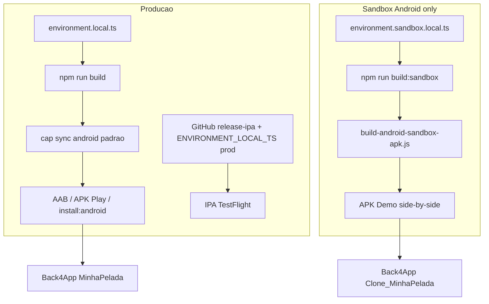

# Ambientes de build — Produção vs Sandbox (guia para agents)

**Leia este arquivo antes** de gerar APK, AAB, IPA, bump de versão ou alterar `capacitor.config` / `android/`.

O **Controle de Bola App** tem **dois backends Back4App** distintos. Trocar chaves ou pacote Android sem seguir o fluxo certo causa: app apontando para base errada, overwrite do app da Play no celular, ou **build number** iOS duplicado na Apple.

---

## Visão geral

| | **Produção** | **Sandbox (apresentação / demo)** |
|---|-------------|-----------------------------------|
| **Back4App** | **MinhaPelada** (base go-live, pós-purge) | **Clone_MinhaPelada** (cópia pré-purge) |
| **Chaves Parse (cliente)** | `src/environments/environment.local.ts` | `src/environments/environment.sandbox.local.ts` |
| **Build Angular** | `production` → `environment.prod.ts` + **local prod** | `sandbox` → `environment.sandbox.ts` + **local sandbox** |
| **Android `applicationId`** | `com.minhapelada.app` | `com.minhapelada.app.sandbox` |
| **Nome no launcher** | Controle de Bola | Controle de Bola (Sandbox) |
| **Capacitor config** | [`capacitor.config.ts`](../capacitor.config.ts) | [`capacitor.config.sandbox.ts`](../capacitor.config.sandbox.ts) (via script) |
| **iOS / TestFlight / App Store** | **Sim** — único ambiente oficial | **Não** — não há IPA sandbox no repo |
| **Bump release** (`prebuild`) | **Sim** em `npm run build` | **Não** — use `npm run build:sandbox` |



---

## Arquivos sensíveis (nunca commitar)

| Arquivo | Ambiente |
|---------|----------|
| `src/environments/environment.local.ts` | Produção |
| `src/environments/environment.sandbox.local.ts` | Sandbox |

Templates no repo: `environment.local.ts.example`, `environment.sandbox.local.ts.example`.

**GitHub Actions (iOS):** secret `ENVIRONMENT_LOCAL_TS` = conteúdo de **`environment.local.ts` de produção** — nunca colar chaves do clone.

---

## Produção — procedimentos corretos

### Web / base do Capacitor

```powershell
npm run build
```

- Roda **`prebuild`** → incrementa `.app-release-state.json`, `app-release.ts`, `versionCode` Android.
- Usa chaves de **`environment.local.ts`**.

### Android — instalar no dispositivo (release)

```powershell
npm run install:android
# ou APK em releases/: npm run export:android-apk
```

- Pacote: **`com.minhapelada.app`**
- Após qualquer build sandbox, **restaurar** Android de produção (abaixo).

### Android — Google Play (AAB)

```powershell
npm run build:android:aab
```

- Sempre com **`environment.local.ts`** de produção e **`cap sync android`** padrão (sem script sandbox).

### iOS — IPA / TestFlight

1. Conferir [IOS-APP-STORE-VERSION-SEQUENCE.md](IOS-APP-STORE-VERSION-SEQUENCE.md) — **duas** checagens: `versionCode` > último build TestFlight **e** `package.json` `"version"` > marketing **aprovada/fechada** no Connect (erros **90062** / **90186** se a trilha já fechou; comum após subir AAB Play no mesmo `1.0.x`).
2. **Commit + push** na `main` de `.app-release-state.json`, `app-release.ts`, `android/app/build.gradle` (e código do release). **Sem push**, o Actions usa `versionCode` antigo + prebuild → **409 duplicate** (ex. TestFlight já em 282, CI reenvia 282).
3. Workflow: [ios-capacitor-build.yml](../.github/workflows/ios-capacitor-build.yml) → **`release-ipa`** (Run workflow na `main` nova; IPA efetivo = `versionCode` commitado **+ 1**).
4. Secret **`ENVIRONMENT_LOCAL_TS`** = produção (MinhaPelada).
5. Export compliance: [APP-STORE-EXPORT-COMPLIANCE.md](APP-STORE-EXPORT-COMPLIANCE.md).

Detalhes: [IOS_GITHUB_ACTIONS.md](IOS_GITHUB_ACTIONS.md), [AGENTS.md](../AGENTS.md) (seção iOS).

### Operações Back4App (produção only)

- Purge / go-live: [PROD-DATA-PURGE.md](PROD-DATA-PURGE.md) — app **MinhaPelada**, nunca o clone.

---

## Sandbox — procedimentos corretos (Android demo)

### Configuração (uma vez por máquina)

```powershell
copy src\environments\environment.sandbox.local.ts.example src\environments\environment.sandbox.local.ts
```

Preencher **Application ID** e **JavaScript Key** do app **Clone_MinhaPelada** no painel Back4App.

### Gerar APK demo

```powershell
npm run build:android:sandbox-apk
```

O script [`scripts/build-android-sandbox-apk.js`](../scripts/build-android-sandbox-apk.js):

1. Exige `environment.sandbox.local.ts`
2. `npm run build:sandbox` (**sem** bump de release)
3. Aplica temporariamente config sandbox + `applicationId` `.sandbox`
4. `cap sync android` + `assembleRelease`
5. Restaura `capacitor.config.ts` e `build.gradle` de produção
6. Copia APK para `releases/ControleDeBola-sandbox-YYYY-MM-DD.apk`

Instalação:

```powershell
adb install -r releases\ControleDeBola-sandbox-YYYY-MM-DD.apk
```

Guia operacional: [SANDBOX-CLONE-APK.md](SANDBOX-CLONE-APK.md).

### Restaurar pasta Android para produção (obrigatório após sandbox)

O sync sandbox altera artefatos em `android/`. Antes de AAB/Play ou `install:android` de **produção**:

```powershell
npm run build
npx cap sync android
```

Confirme em `android/app/build.gradle`: `applicationId "com.minhapelada.app"`.

---

## Erros comuns (evitar)

| Erro | Consequência | Correção |
|------|--------------|----------|
| `npm run build` antes de demo sandbox | Consome `versionCode` / release label | Use só `build:sandbox` + `build:android:sandbox-apk` |
| Chaves **MinhaPelada** em `environment.sandbox.local.ts` | Demo mostra base vazia pós-purge | Chaves do **Clone_MinhaPelada** |
| Chaves **clone** em `environment.local.ts` | Play/TestFlight apontam para clone | Só chaves **MinhaPelada** em prod |
| Sandbox sem restaurar `cap sync` prod | AAB assinado com pacote errado | `npm run build` + `npx cap sync android` |
| `prodDataPurge` no clone | Apaga backup de demo | Purge só **MinhaPelada** |
| IPA com secret clone | TestFlight em backend errado | `ENVIRONMENT_LOCAL_TS` = prod |
| Reutilizar build iOS já enviado | Rejeição Apple 409 | [IOS-APP-STORE-VERSION-SEQUENCE.md](IOS-APP-STORE-VERSION-SEQUENCE.md) |

---

## Checklist rápido (agents)

**Vou gerar artefato de produção (Play / TestFlight / install release prod)?**

- [ ] `environment.local.ts` = **MinhaPelada**
- [ ] **Não** rodei `build:android:sandbox-apk` na mesma sessão sem restaurar (`build` + `cap sync android`)
- [ ] iOS: li sequência de versão + push antes do workflow
- [ ] Android loja: `build:android:aab` ou `install:android`, não script sandbox

**Vou gerar APK demo (apresentação)?**

- [ ] `environment.sandbox.local.ts` = **Clone_MinhaPelada**
- [ ] `npm run build:android:sandbox-apk` (não `npm run build` sozinho para esse fim)
- [ ] Instalar APK `.sandbox`; produção continua com pacote `com.minhapelada.app`
- [ ] Avisar humano: e-mail/SMS no clone podem falhar sem `SMTP_*` no clone

---

## Referências cruzadas

| Documento | Conteúdo |
|-----------|----------|
| [AGENTS.md](../AGENTS.md) | Comandos gerais, iOS CI, regras críticas |
| [SANDBOX-CLONE-APK.md](SANDBOX-CLONE-APK.md) | Demo Android detalhado |
| [IOS-APP-STORE-VERSION-SEQUENCE.md](IOS-APP-STORE-VERSION-SEQUENCE.md) | Marketing + build Apple |
| [APP-STORE-EXPORT-COMPLIANCE.md](APP-STORE-EXPORT-COMPLIANCE.md) | Criptografia / TestFlight |
| [PROD-DATA-PURGE.md](PROD-DATA-PURGE.md) | Limpeza base **produção** |

**Atualize** este guia se surgir novo flavor, CI sandbox ou segundo bundle iOS.
